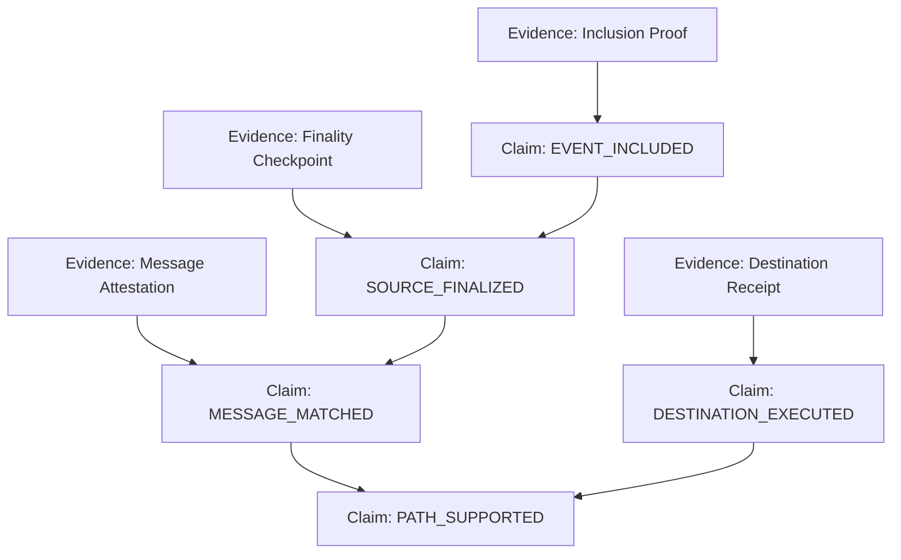

# Phase 0.4A — Claim Taxonomy Specification

**Document ID:** `CHAINTRACE-P0-04A`  
**Version:** 1.0.0  
**Status:** Approved  
**Author:** ChainTrace Core Architecture Team  

---

## 1. Overview & Taxonomy Philosophy

In ChainTrace, verification is never a single monolithic boolean flag (`verified = true`). Instead, verification consists of a graph of discrete, typed **claims**. Each claim asserts a specific proposition about on-chain execution or protocol correspondence and relies on explicit evidence and prerequisite claims.

---

## 2. Claim Types

### 1. `EVENT_INCLUDED`
- **Proposition:** *"An event with specified topics and data was emitted within a canonical transaction on the declared blockchain."*
- **Subject References:** `[event_id, tx_hash]`
- **Required Evidence:**
  - `RECEIPT_REFERENCE`: Transaction receipt matching `tx_hash` with `status === 0x1` and log index matching `event_index`.
  - `INCLUSION_PROOF`: Merkle Patricia receipt proof relative to block header receipt root.
- **Prerequisites:** None (Root factual claim).
- **Evaluation Rules:** Evaluates to `VERIFIED` if evidence passes; `INVALID` if proof fails or receipt indicates reverted status; `INCONCLUSIVE` if evidence is incomplete.

### 2. `SOURCE_FINALIZED`
- **Proposition:** *"The source block containing the referenced event has satisfied the consensus finality policy of the source chain."*
- **Subject References:** `[event_id, block_hash]`
- **Required Evidence:**
  - `AUTHENTICATED_HEADER`: Finalized beacon chain header or checkpoint proof.
- **Prerequisites:** `EVENT_INCLUDED` claim must be `VERIFIED`.
- **Evaluation Rules:** Evaluates to `VERIFIED` if finality proof is valid and parent claim is `VERIFIED`; `REVALIDATION_REQUIRED` if parent requires revalidation; `INVALID` if block was orphaned/reorganized.

### 3. `ATTESTATION_VALID`
- **Proposition:** *"The protocol-specific attestation (e.g., DVN quorum signatures or Wormhole Guardian VAA) is syntactically valid and satisfies the required signature threshold."*
- **Subject References:** `[attestation_hash, message_id]`
- **Required Evidence:**
  - `MESSAGE_ATTESTATION`: Signed payload with verifier signatures and threshold confirmation.
- **Prerequisites:** None or `SOURCE_FINALIZED` depending on bridge policy.
- **Evaluation Rules:** Evaluates to `VERIFIED` if signatures match authorized validator set and threshold $\ge M/N$.

### 4. `MESSAGE_MATCHED`
- **Proposition:** *"The source message emitted on Chain A corresponds to the message received on Chain B under protocol domain-separation and payload identity rules."*
- **Subject References:** `[source_event_id, destination_event_id]`
- **Required Evidence:**
  - Protocol message payload attestation and parameter matching.
- **Prerequisites:** `SOURCE_FINALIZED` and `ATTESTATION_VALID`.
- **Evaluation Rules:**
  - Evaluates to `VERIFIED` if message identifiers (e.g. `guid`) and payloads match exactly.
  - Evaluates to `INVALID` with reason `MESSAGE_ID_MISMATCH` if identifiers differ.
  - Evaluates to `INCONCLUSIVE` if attestation or destination receipt is unavailable.

### 5. `DESTINATION_EXECUTED`
- **Proposition:** *"A transaction was executed on the destination chain that processed the message and resulted in a successful execution status."*
- **Subject References:** `[destination_event_id, destination_tx_hash]`
- **Required Evidence:**
  - `RECEIPT_REFERENCE`: Destination receipt with status `0x1`.
- **Prerequisites:** None (Independent factual observation on the destination chain).
- **Crucial Invariant:** Independent of whether the bridge relationship is valid or invalidated, the destination transaction's physical execution remains an immutable historical observation.

### 6. `PATH_SUPPORTED`
- **Proposition:** *"The end-to-end cross-chain path from source emission to destination execution is fully supported and verified by unbroken evidence."*
- **Subject References:** `[source_event_id, destination_event_id]`
- **Required Evidence:** None (Composite claim derived from parent claims).
- **Prerequisites:** `EVENT_INCLUDED`, `SOURCE_FINALIZED`, `MESSAGE_MATCHED`, and `DESTINATION_EXECUTED`.
- **Evaluation Rules:**
  - `VERIFIED` if and only if **all** required prerequisite claims are `VERIFIED`.
  - `REVALIDATION_REQUIRED` if any prerequisite is marked `REVALIDATION_REQUIRED`.
  - `INVALID` if any required prerequisite is `INVALID`.
  - `INCONCLUSIVE` if any required prerequisite is `INCONCLUSIVE` or `UNVERIFIED`.

---

## 3. Dependency Relationship Matrix

